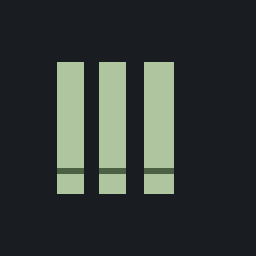

<div align="center">



# MarkVault

**Seu cofre de conhecimento em arquivos Markdown. Local, rápido e sem lock-in.**

[](https://github.com/lucodifier/markvault/releases/latest)


[**⬇ Baixar**](https://github.com/lucodifier/markvault/releases/latest) · [**Site do projeto**](https://lucodifier.github.io/markvault/) · [Documentação](docs/CONTINUIDADE.md)

</div>

---

MarkVault é um aplicativo desktop que transforma uma pasta comum de arquivos `.md` em um cofre de notas. Não há banco de dados, conta, nuvem ou formato proprietário: se o aplicativo sumir amanhã, você ainda tem uma pasta de texto puro legível por qualquer editor.

## Recursos

- **Pasta como cofre:** abra qualquer pasta local; árvore com criar, renomear e excluir (com confirmação) e sidebar redimensionável.
- **Editor com 4 modos:** CodeMirror 6 com realce Markdown e números de linha, em modo **Markdown**, **Dividido**, **Preview** ou **Leitura**.
- **Busca:** por nome/caminho (ignora acentos, ordena por relevância) e **no conteúdo** das notas, com resultados por linha.
- **Salvamento seguro:** autosave em 700 ms, escrita atômica com verificação de revisão SHA-256 e rascunhos de emergência para recuperação.
- **Alterações externas:** watcher nativo atualiza árvore e documento; conflitos nunca sobrescrevem em silêncio.
- **Markdown completo:** tabelas GFM, tarefas, blocos de código, imagens locais/HTTPS e links relativos entre notas.
- **Mover arquivos:** arraste notas e pastas na árvore (inclusive entre pastas abertas) ou use **Mover para…** no menu.
- **Leitura confortável:** modo Leitura com texto e largura ajustáveis (`Ctrl +`/`Ctrl -`); clique em um diagrama Mermaid para ampliar, com zoom e arrastar.
- **Produtividade:** copiar caminho absoluto, relativo ou link Markdown pelo menu de contexto.
- **Segurança:** caminhos confinados à pasta, sem symlinks/junctions, HTML arbitrário não executa, anexos só de tipos permitidos.

### Atalhos

| Atalho | Ação |
| --- | --- |
| `Ctrl+P` | Abrir nota por nome/caminho |
| `Ctrl+Shift+F` | Buscar no conteúdo |
| `Ctrl+N` | Nova nota |
| `Ctrl+S` | Salvar agora |
| `Ctrl+\` | Mostrar/ocultar o explorador |

## Instalação (Windows)

1. Baixe `MarkVault_0.5.0_x64-setup.exe` na [página de releases](https://github.com/lucodifier/markvault/releases/latest).
2. Execute o instalador. Ele ainda **não é assinado**, então o SmartScreen pode avisar: clique em *Mais informações → Executar assim mesmo*.
3. Abra o MarkVault, clique em **Abrir pasta local** e escolha sua pasta de notas.

## Sincronizar entre máquinas

O cofre é só uma pasta. Crie-a dentro do **Google Drive** (ou OneDrive, Dropbox, Syncthing) e seus documentos e anexos ficam sincronizados. O watcher do MarkVault recarrega o que chegar de fora.

## Como funcionam os conflitos

Quando há texto local pendente e uma versão diferente no disco, o autosave é interrompido e você escolhe: usar a versão do disco, substituir o disco pelo seu texto (a revisão é conferida de novo antes de gravar) ou salvar uma cópia. Se o arquivo for removido, o texto continua disponível para salvar em outro arquivo. Falhas de escrita bloqueiam a troca de documento e o fechamento normal da janela para permitir a recuperação.

Os rascunhos de emergência ficam no armazenamento local da webview, separados por workspace e caminho, e não substituem backup nem histórico.

## Compilar a partir do código

Pré-requisitos: Node.js 22+, Rust estável (toolchain MSVC), Visual Studio Build Tools com *Desktop development with C++* e WebView2 Runtime.

```powershell
npm install
npm run app            # desenvolvimento (Vite + Tauri)
npm run desktop:build  # executável e instalador NSIS
```

O executável fica em `src-tauri/target/release/markvault.exe` e o instalador em `src-tauri/target/release/bundle/nsis/`.

### Qualidade

```powershell
npm run lint       # ESLint, zero avisos
npm test           # Vitest
npm run build      # tsc + build do Vite
npm run test:rust  # testes Rust com diretórios temporários reais
```

## Stack

React 18 · TypeScript · Vite 6 · Zustand · CodeMirror 6 · react-markdown + GFM · Tauri 2 · Rust (`notify`, SHA-256).

Mais detalhes em [arquitetura](docs/ARCHITECTURE.md), [validação](docs/VALIDATION.md) e [continuidade](docs/CONTINUIDADE.md).

## Limitações atuais (v0.5.0)

- Um documento aberto por vez; sem abas.
- Tema escuro apenas; sem grafo de notas, plugins ou IA.
- Limites: 16 MB por documento, 20 MB por imagem, 64 níveis de diretórios; a árvore é carregada por inteiro.
- O workspace deve ser uma pasta local confiável.
- Somente Windows/NSIS por enquanto, sem assinatura de código.

## Autor

Licença [MIT](LICENSE). Feito por [lucodifier](https://github.com/lucodifier). Veja também o [Dachshund](https://lucodifier.github.io/dachshund-landing/).
